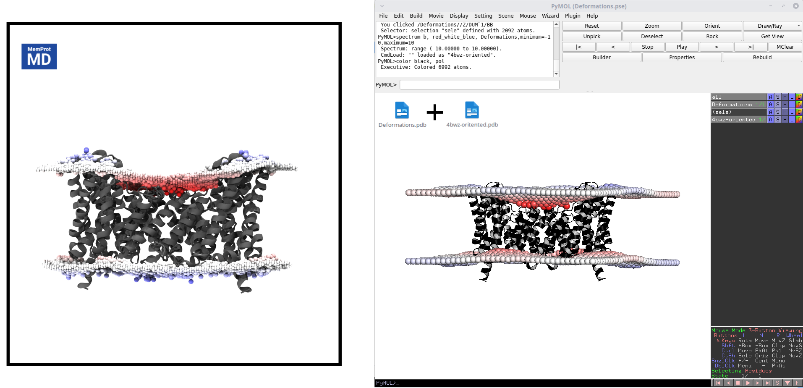

# MemPrOD
MemPrOD: Membrane Protein Orientation and Distortions is a program that predicts the distortions of a lipid bilayer around a membrane protein. A paper describing MemPrOD is in preparation; MemPrOD builds on MemPrO ([Parrag & Stansfeld, J. Chem. Theory Comput. 2025](https://doi.org/10.1021/acs.jctc.5c01433)). 

Parameters from the following were used to help write this code:

**Martini forcefield:**
Siewert J ; Marrink et al. “The MARTINI force field The MARTINI Force Field: Coarse Grained Model for Biomolecular Simulations”. In: (2007). [Paper](https://pubs.acs.org/doi/10.1021/jp071097f)

## Installation
To install MemPrOD run the following:
>pip install memprod

This will install MemPrO, Insane4MemPrO and MemPrOD. For NVIDIA GPU support in the MemPrO parts (Linux, CUDA 12), use:
>pip install "memprod[gpu]"

Otherwise, clone the GitHub repository and install it with `pip install .` from the repository folder. Python 3.11 or later is required; this installs MemPrO 0.2.1 or later, JAX (0.6.0–0.11) and SciPy.

The Martini 3 force field bundled with MemPrO is used by default. To use a different one, supply it with `-itp`, or set the following environment variable (for Linux users):

>export PATH_TO_MARTINI=PATH/TO/MARTINI3

### Google Colab

MemPrOD can be run without installing anything locally, using the [MemPrO Colab notebook](https://colab.research.google.com/github/pstansfeld/MemPrO/blob/main/MemPrO_Colab.ipynb). Tick **Run_MemPrOD** in its Settings cell, then use *Runtime → Run all*: the notebook orients the protein with MemPrO, runs MemPrOD on the top-ranked orientation (with MemPrO's dummy membrane removed), and shows the deformation maps. This covers single-membrane systems, as MemPrOD does.

## Outputs

MemPrOD is intended to run on either CG or atomistic PDB files of an oriented protein (e.g. `oriented_rank_1.pdb` from MemPrO). The input must contain the protein only: remove MemPrO's dummy membrane (`DUM`) beads first, for example with `grep -v " DUM " oriented_rank_1.pdb > protein.pdb`.

MemPrOD will output the following data:

* Membrane_Data - A folder that contains additional data, mainly .npz files for building CG systems with distortions using Insane4MemPrO.
  
    * All_beads.pdb - A pdb file containing all beads used in calculations. Mostly for debugging.
      
    * Surface.pdb - A pdb file showing the surface beads calculated. Again, mostly for debugging
      
* LocData - A folder of .npz files with the upper and lower leaflet heights of each membrane segment (TopData, BotData), masks that are 1 for segments kept and 0 for segments removed because they lie inside the protein (TopBan, BotBan), and the grid coordinates (Xlin, Ylin).
  
* AcylTail_contacts.pdb - A pdb file of the original input with b-factors as acyl tail contacts. This is still WIP.
  
* HeadGroup_contacts.pdb - As above but with b-factors as head group contacts. This is still WIP.
  
* Deformations.pdb - A pdb file containing a representation of the deformations only.
  
* Deformations_Lower.svg - A height map of the deformations in the lower leaflet.
  
* Deformations_Upper.svg - As above but for the upper leaflet.
  
* Charge_Lower.svg - A graph of the charge in the lower leaflet, calculated after deformations.
  
* Charge_Upper.svg - As above but for the upper leaflet.
  
* Potential_Lower.svg - A graph of the potential of each membrane segment in the lower leaflet.
  
* Potential_Upper.svg - As above but for the upper leaflet.
  
* Run_command.txt - A text file containing the full run command for later reference.

## Flags
MemPrOD takes the following flags as input:

-h, --help : This will display a help message with all possible flags and some information on their use.

-f, --file_name : (Required) This is the name of the input file for the protein that you wish to predict deformations for. It must be a .pdb. In future support for .gro files may be added. The protein can be either atomistic or coarse grained. The code should detect which it is and ignore unknown atom/bead types, however in the case of an error please let me know and send me the file which caused it. It is recommended that the PDB files had no missing atoms as this can cause the predictions to be of lower quality.

-o, --output : This is the name of the ouput directory. The code will default to a folder called Deformations in the directory where the code is run.

-ni, --iters : Number of minimisation iterations. (Default: 300)

-ng, --grid_density : The spacing between membrane segments. It is highly recommended to use values above 2 as low values can quickly become very expensive. (Default: 3)

-ncav, --no_cavity_surface : This toggles the use of a more expensive but more accurate surface finder. By default the more expensive algorithm is used but this flag will turn it off.

-itp, --itp_file : Path to a Martini3 forcefield. By default this is the enviroment variable PATH_TO_MARTINI if set, otherwise the force field bundled with MemPrO

-cut, --cutoff : This is the cutoff for interactions between membrane segments and protein beads. It is not reccommended to change this. (Default: 12)

-k1, --k1_const : This scales the strength of membrane-membrane interactions. It is not reccommended to change this. (Default: 0.25)

-k2, --k2_const : This scales the potential associated with compression and extension of the membrane. This is not generally required and should not be change unless you know what you're doing. (Default: 0)

-sm, --smooth : Width (Angstrom, Gaussian sigma) the upper and lower membrane surfaces are smoothed over after minimisation. Each surface is averaged only over the cells where its leaflet has membrane, so the protein does not pull the edge down. This removes steps between neighbouring membrane segments without changing the overall deformation; 0 turns it off. (Default: 5)

-zshift, --zshift : This changes the starting Z position of the protein. (Default: 0)

-mt, --membrane_thickness : This indicates what the undeformed membrane thickness should be in angstroms. (Default: 38)

-wb, --write_bfactors : Toggles the writing of charge at each membrane segment rather than thinning/thickening.

-enc, --enclosed : How to treat regions the protein encloses in the membrane, where a lipid fits but cannot be reached from outside the protein (the inside of a ring or barrel). auto predicts membrane in a region where the narrowest slice of the hydrophobic core has at least 1 nm2 free and at least 60% of the residues lining it are hydrophobic (ALA, VAL, LEU, ILE, MET, PHE, TRP, CYS, PRO), the same rule as Insane4MemPrO -enclosed auto, so a lipid-filled ring such as a c-ring is predicted while a water-filled pore is not. lipids predicts membrane in every enclosed region, and empty treats them as protein (the behaviour before this option). Each region found is printed with its free area, lining and the decision. (Default: auto)

-bd, --build_system and -bd_args, --build_arguments : Accepted for compatibility with MemPrO but not yet used; MemPrOD does not currently build a CG system. The files in Membrane_Data can be used with Insane4MemPrO.

-res, --additional_residues : A comma separated list of additional residues present in the input file (eg POPE,POPG)

-res_itp, --additional_residues_itp_file : An itp file containing descriptions of each additional residue added.

-res_cg, --residue_cg_file : A folder containing files called RES.pdb where RES is the name of each additional residue added. RES.pdb should contain coarse graining information, example can be found on the GitHub repo for [CG2AT](https://github.com/owenvickery/cg2at/tree/master/database/fragments/martini_3-0_slipids/non_protein). This is only required for atomistic inputs with additional residues.

## An example

MemPrOD is a very simply code to use, here we will go through a quick example. The first step will be to download an exmaple integral membrane protein, let us choose 4BWZ from the protein data bank. We will be downloading this from MemProtMD rather than the protein data bank. Go to [this page](https://memprotmd.bioch.ox.ac.uk/_ref/PDB/4bwz/_sim/4bwz_default_dppc/) and download "4bwz_default_dppc-head-contacts.pdb" rename this to "4bwz.pdb". Create a folder called "MemPrOD_Example" and place "4bwz.pdb" in this folder. **NOTE: If installing with pip then `mempro` and `MemPrOD` can be used to run the code instead of the full path as shown in the example and tutorials below. In a clone of the repositories the scripts are `mempro/MemPrO.py` (MemPrO) and `src/memprod/MemPrOD.py` (MemPrOD).**

Before we can predict deforamtions we will first need to orient the protein. If you are unfiamilar with MemPrO then take a look at the [MemPrO tutorials](https://github.com/pstansfeld/MemPrO/blob/main/MemPrO_tutorials.md). We can orient by running the following command in "MemPrOD_Example".

>python PATH/TO/MemPrO.py -f 4bwz.pdb

This will create a folder called "Orient". To get the oriented protein run the following:

> sed '/DUM/d' ./Orient/Rank_1/oriented_rank_1.pdb > 4bwz-oriented.pdb

This will create a file called "4bwz-oriented.pdb". We can now run the following command:

>python PATH/TO/MemPrOD.py -f 4bwz-oriented.pdb

This should take under a minute on a typical CPU and will create a folder called "Deformations". In this folder we can find "Deformations.pdb" Load "4bwz-oriented.pdb" and "Deformations.pdb" in PyMOL. We can improve the clarity of the deformations by running the following command in PyMOL:

>spectrum b, red_white_blue,Deformations,minimum=-10,maximum=10

We can compare this to the deformations shown on MemProtMD, and we see good agreement in general, with MemPrOD over prediciting thinning on the lower leaflet slightly.

## FAQ
There are currently no frequently asked questions. If you do have any questions or encounter errors that you cannot fix please contact me via my email m.parrag@warwick.ac.uk and I will do my best to provide help.

